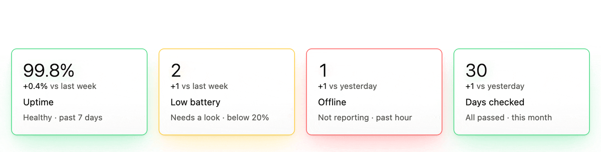
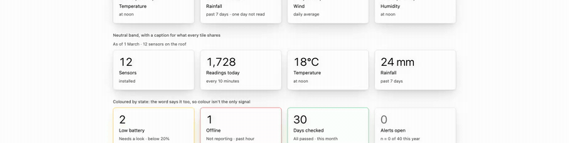
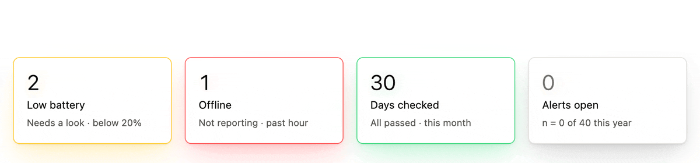
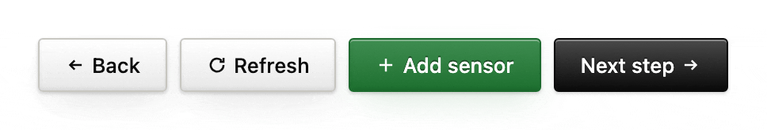
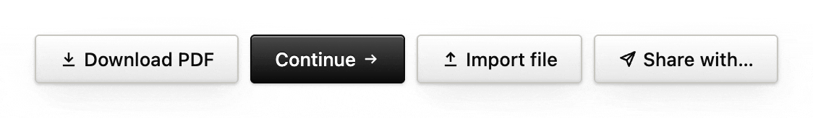
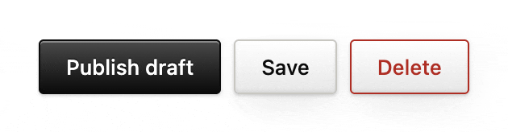

# ui

Small UI components in plain CSS and JavaScript. There's no framework and no build step: copy a component's folder and `tokens.css`, and it works in any page, whether that's plain HTML, server templates, React or Vue.

| Component | What it is | Demo |
| --- | --- | --- |
| [Button](src/components/button/) | A lit button with primary, go and danger variants, busy and disabled states, and a press guard. | [Live demo](https://hankstoreo.github.io/ui/src/components/button/) |
| [KPI tile](src/components/kpi-tile/) | A band of figures, each with a label, an optional change line, a sparkline and a definition. | [Live demo](https://hankstoreo.github.io/ui/src/components/kpi-tile/) |













The demos also work offline: open a component's `index.html` from a clone.

## Install

Copy `src/tokens.css`, the files in `src/shared/` that a component lists, and that component's folder into your project. Then link them:

```html
<link rel="stylesheet" href="tokens.css">
<link rel="stylesheet" href="shared/spinner.css">
<link rel="stylesheet" href="components/button/button.css">
<script src="components/button/button.js" defer></script>
```

There's nothing to install from npm. The `package.json` is only for running the tests.

## Light and dark

The components follow the system colour scheme. To choose one yourself, set `data-theme="light"` or `data-theme="dark"` on `<html>`. Under reduced motion, every transition and animation duration is 0ms.

`tokens.css` defines the custom properties the components read: colours, spacing, type and motion. It's generated, so change a value by overriding it in your own stylesheet rather than by editing the file.

## Browser support

The CSS relies on recent features: `light-dark()`, `color-mix()`, container query units, `@container style()` queries and `transition-behavior: allow-discrete`. Every test passes in:

| Engine | Version tested |
| --- | --- |
| Chromium (Chrome) | 157 |
| Firefox | 155 |
| WebKit (Safari) | 26.6 |

Older versions are untested. The tests check accessible names and descriptions as Playwright computes them from the DOM in each engine. Real screen readers haven't been tested.

## Tests

```sh
npm install
npx playwright install
npm test
```

The tests run every component test and every demo page (including an axe accessibility scan in light and dark) in Chromium, Firefox and WebKit.

The gifs and videos in `docs/media/` are recorded from the demo pages by `npm run media` (needs ffmpeg). Rerun it after any visual change.

## Licence

[MIT](LICENSE)
