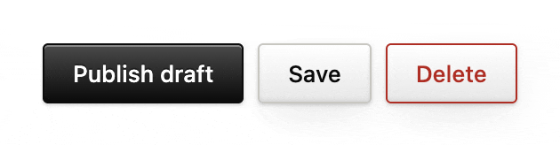
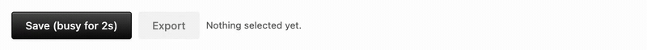
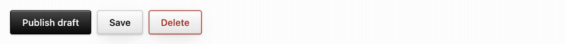
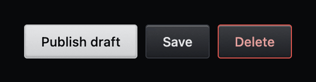

# Button

A button lit from above, with a gradient and soft shadows taken from its own colour. It has primary, go and danger variants, busy and disabled states, and a press guard that stops a busy or switched-off button from acting.



[Live demo](https://hankstoreo.github.io/ui/src/components/button/) · [Demo source](index.html) · [Tests](button.test.js)

## Install

Copy `tokens.css`, `shared/spinner.css` and this folder. The script is only needed for the press guard.

```html
<link rel="stylesheet" href="tokens.css">
<link rel="stylesheet" href="shared/spinner.css">
<link rel="stylesheet" href="components/button/button.css">
<script src="components/button/button.js" defer></script>
```

## Use

```html
<div class="btn-row">
  <button type="button" class="btn btn--primary">Publish draft</button>
  <button type="button" class="btn">Save</button>
  <button type="button" class="btn btn--danger">Delete</button>
</div>
```

Busy: wrap the label in `.btn-label` and add a spinner. Then set `aria-busy="true"` while the work runs, and remove it when the work is done.



```html
<button type="button" class="btn btn--primary" aria-busy="true">
  <span class="spinner" aria-hidden="true"></span><span class="btn-label">Publish draft</span>
</button>
```

### In React

```jsx
<button type="button" className="btn btn--primary" aria-busy={saving}>
  <span className="spinner" aria-hidden="true" /><span className="btn-label">Publish draft</span>
</button>
```

## Variants and options

| Class / attribute | Effect |
| --- | --- |
| `.btn` | The default button. |
| `.btn--primary` | The one main action in a view. |
| `.btn--go` | Confirms a step or marks it done. Use it in the primary's place, not beside it. |
| `.btn--danger` | Removes or destroys. Quiet at rest, it fills red on hover. |
| `disabled` | Off, and out of the tab order. |
| `aria-disabled="true"` | Off, but still focusable, so its reason can be heard. Put the reason in `.btn-reason` and link it with `aria-describedby`. |
| `aria-busy="true"` | A spinner replaces the label. The button keeps its width and its accessible name. |
| `.icon` | An inline SVG sized to the text (`aria-hidden="true"`). |
| `.btn-row`, `.btn-row--end` | A row of buttons: left aligned (primary first), or right aligned (dialogs: Cancel, then OK). |

## Behaviour and accessibility

- **Press guard (`button.js`):** a click on a `.btn` with `aria-busy="true"` or `aria-disabled="true"` is dropped before any handler runs, and a form doesn't submit. Enter and Space are covered too, because they arrive as clicks. The guard affects `.btn` elements only. Other buttons, links and inputs on the page are left alone, and so is a busy ancestor.
- **Keyboard focus:** a 2px ring in the variant's colour, with a gap of page between the ring and the button. The ring is drawn with shadows, plus a transparent outline for Windows high-contrast mode.

  
- **Busy:** the label is hidden by opacity only, so it stays the button's accessible name.
- **Hover:** the lift and glow apply only where a pointer can hover, so a tap doesn't leave the button lifted.
- **Reduced motion:** transitions and the spinner stop.
- **Print:** a flat fill with no shadows.
- **Contrast:** in dark mode, the danger label is lightened so it stays at or above 4.5:1 against both ends of the gradient.

  

## Limitations

- **The label never wraps.** Keep it to a few words, or let the `.btn-row` wrap.
- **One size.**
- **Recent browsers only.** See [browser support](../../../README.md#browser-support).
