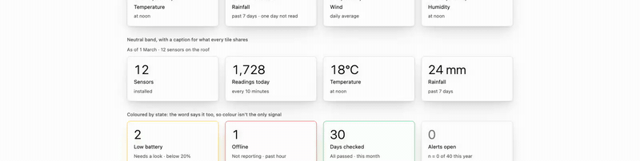
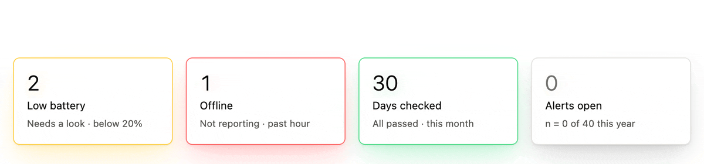
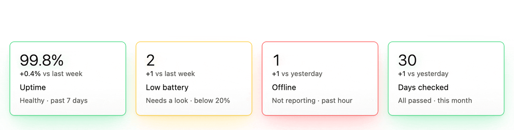
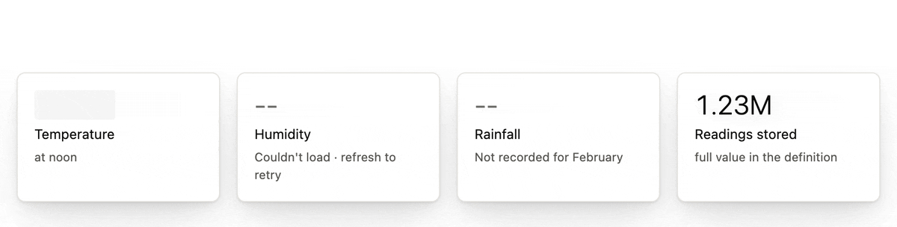

# KPI tile

A band of headline figures. Each tile shows a figure and its label, and can add a change line, a unit or period, a sparkline of the trend and a definition. A tile that counts things links to them.



[Live demo](https://hankstoreo.github.io/ui/src/components/kpi-tile/) · [Demo source](index.html) · [Tests](kpi-tile.test.js)

## Install

Copy `tokens.css`, `shared/sr-only.css` and this folder. The script draws the sparklines, sizes the figures, and wires up names and descriptions.

```html
<link rel="stylesheet" href="tokens.css">
<link rel="stylesheet" href="shared/sr-only.css">
<link rel="stylesheet" href="components/kpi-tile/kpi-tile.css">
<script src="components/kpi-tile/kpi-tile.js" defer></script>
```

## Use

```html
<p class="kpis-cap">As of 1 March · 12 sensors</p>
<div class="kpis">
  <a class="kpi" href="/temperature" data-tip="Air temperature at noon today" data-spark="12,13,15,14,16,17,18">
    <span class="kpi-v">18°C</span>
    <span class="kpi-d"><span class="signed">+1°C</span> vs yesterday</span>
    <span class="kpi-l">Temperature</span>
    <span class="kpi-n">at noon</span>
  </a>
  <div class="kpi" tabindex="0" data-tip="Hours of sunshine recorded today">
    <span class="kpi-v">8 h</span><span class="kpi-l">Sunshine today</span>
  </div>
</div>
```

### In React

```jsx
<div className="kpis">
  <a className="kpi" href="/temperature" data-tip="Air temperature at noon today" data-spark={series.join(',')}>
    <span className="kpi-v">18°C</span><span className="kpi-l">Temperature</span>
  </a>
</div>
```

The script watches the page, so tiles that React adds or changes are handled automatically.

## Variants and options

| Class / attribute | Effect |
| --- | --- |
| `.kpis` | The band. It wraps on its own width, and tiles never go below `--kpi-min` (10rem). |
| `.kpis-cap` | A caption before the band, for what every tile shares. |
| `.kpi-v`, `.kpi-l` | The figure and its label (both required). |
| `.kpi-d` | Optional: how the figure moved, in words. Put the signed part in `.signed`. |
| `.kpi-n` | Optional: the unit, population or period. |
| `a.kpi` | A tile that opens its items. It lifts on hover. |
| `div.kpi[tabindex="0"]` | A figure that opens nothing. It's named as a group by its figure and label. |
| `data-tip` | The definition. It shows on hover and keyboard focus, and is the tile's accessible description. |
| `data-spark="v1,v2,…"` | Draws a sparkline behind the text, oldest value first. A blank or non-number is a gap, a value alone between gaps is a dot, and fewer than two numbers draws nothing. |
| `.kpi--warn`, `.kpi--alert`, `.kpi--ok` | A tile that counts a state. Its edge, glow and line take the state's colour. Say the state in `.kpi-n` too, so colour isn't the only signal. |
| `.kpi--zero` | Nothing waiting: the figure goes quiet. |
| `.kpi--loading` + `aria-busy="true"` | A placeholder bar. Put `<span class="sr-only">Loading</span>` in `.kpi-v`. |
| `.kpi--error`, `.kpi--missing` | Shows `--`. Put a word (`No figure`, `No value`) in `.sr-only` inside `.kpi-v`, and say why in `.kpi-n`. |







## Behaviour and accessibility

- **Long figures:** a figure shows at most 10 characters. Abbreviate a longer one (`1.23M`) and put the full value in its `aria-label` and in the definition.
- **Figure size:** the figure shrinks to fit its tile, from the title size down to 16px, based on how many characters it has.
- **Definition:** the script adds a hidden element after each tile holding the `data-tip` text, and points `aria-describedby` at it. The visible tooltip is CSS only, and screen readers skip it.
- **Sparkline:** decorative and `aria-hidden`. The figure, not the shape, is the claim. Put the trend in words in `.kpi-d`.
- **Reduced motion:** the line doesn't animate in, and the loading bar stands still.
- **Changes after load:** one `MutationObserver` on the document redraws a tile when its `data-spark` or `data-tip` changes, and handles tiles added later. To redo part of the page by hand, call `kpiTile.render(root)` (the script's only global).

## Limitations

- **A linked tile can still be followed while loading.** If that's wrong for your page, leave out `href` until the figure arrives.
- **The definition can be clipped.** It's a CSS tooltip drawn above the tile, with no collision handling: an `overflow: hidden` ancestor or the top of the viewport can cut it off. Leave room above the band, or don't clip it.
- **No definition on touch for a linked tile.** There's no hover, so a tap follows the link. A static tile shows its definition when focused. Screen readers get it either way, as the tile's description.
- **The observer watches the whole document.** That hasn't been profiled on very large pages.
- **Recent browsers only.** See [browser support](../../../README.md#browser-support).
